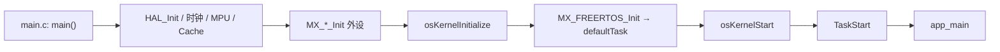
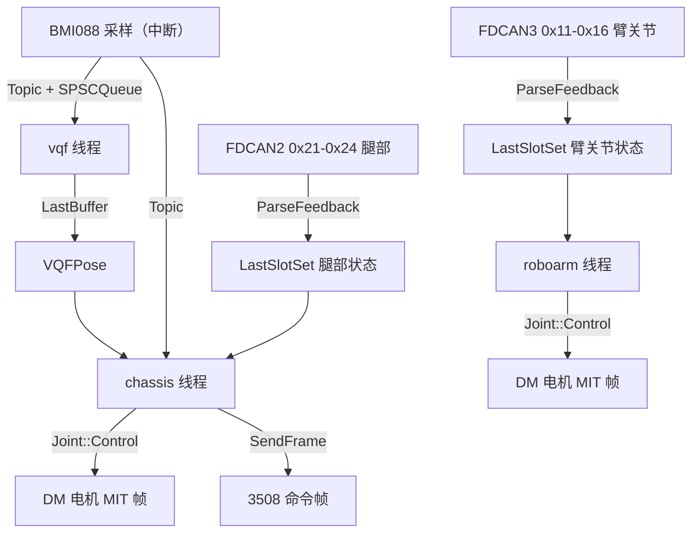
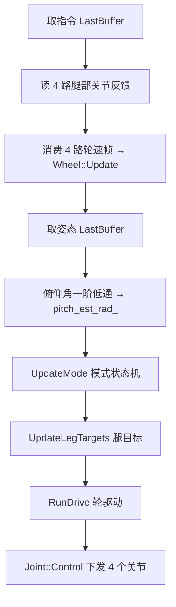

# step_climber

吉林大学 TARS Go 战队台阶攀爬底盘的嵌入式控制程序。基于 [LibXR](https://github.com/xrobot-org/libxr)，运行在 STM32H723VG + FreeRTOS。
代码按 **算法 / 驱动 / 中间件 / 线程** 四层组织，设备装配集中在 `User/app_main.cpp`。

---

## 1. 技术栈

| 项 | 内容 |
|---|---|
| MCU | STM32H723VG（Cortex-M7，I-Cache / D-Cache 开启，MPU 分区） |
| RTOS | FreeRTOS（CMSIS-RTOS2 接口，`configTICK_RATE_HZ = 1000`） |
| 框架 | LibXR：设备抽象、Topic/SPSC、线程、软定时器、看门狗 |
| 构建 | CMake + Ninja，`arm-none-eabi-gcc`，C++20 |
| 生成 | STM32CubeMX（`.ioc`）生成 `Core/`、`Drivers/`；`libxr gen` 生成 `app_main.cpp` 骨架 |

---

## 2. 目录结构

```
Core/                  CubeMX 生成：时钟、外设初始化、中断、FreeRTOS 配置
Drivers/               CMSIS + STM32H7 HAL
Middlewares/
  Third_Party/LibXR    框架（git submodule）
  Third_Party/FreeRTOS
User/
  app_main.cpp         设备装配 + 线程创建（生成骨架，只在 User Code Begin/End 间手写）
  libxr_config.yaml    生成器配置（缓冲区大小、DMA 段、队列深度、看门狗）
  algo/                纯算法：PID、Kalman、RLS、VQF、无锁容器、数学工具
  drv/                 设备驱动：BMI088、达妙 DM、大疆 GM3508、蜂鸣器、WS2812
  midware/             控制中间件：Joint、Chassis、Arm_Controller
  threads/             线程入口与参数结构
```

### 分层与依赖方向

| 层 | 允许依赖 | 职责 |
|---|---|---|
| `algo` | 仅标准库 | 不碰硬件、不碰 RTOS，可主机侧测试 |
| `drv` | `algo` + LibXR 设备 | 只负责「CAN/SPI 报文 ↔ 物理量」换算 |
| `midware` | `algo` + `drv` | 控制逻辑，不直接操作 HAL 句柄 |
| `threads` | 全部 | 线程入口，负责节拍与数据搬运 |

---

## 3. 启动链路



`app_main()` 内的执行顺序：

1. `STM32TimerTimebase`（htim6）→ `PlatformInit`（软定时器优先级 / 栈深）
2. 构造全部外设对象：ADC / SPI / UART / FDCAN / PWM / GPIO / IWDG
3. 构造驱动、关节表、控制器、跨线程缓冲区
4. 注册 CAN 反馈订阅（`FDCAN::CallbackFD`）
5. 创建各业务线程
6. `while (true) Thread::Sleep(UINT32_MAX)` —— 装配线程自身退出调度

> 入口桥接：`Core/Src/freertos.c` 中的 `TaskStart` 是 CubeMX 生成的 `__weak` 空桩，
> 由 `User/threads/task_start.cpp` 提供**同名的强符号**覆盖它，在里面调用 `app_main()`。
> 这样无需修改任何 CubeMX 生成文件，重新生成也不会丢失入口。

---

## 4. 运行时架构

### 4.1 线程表

| 线程 | 优先级 | 栈（字） | 周期 | 职责 |
|---|---|---|---|---|
| `vqf` | HIGH | 2048 | 1 ms 轮询，排空 IMU 队列 | BMI088 采样 → VQF → 姿态 |
| `chassis` | MEDIUM | 2048 | 2 ms（500 Hz，绝对时刻） | IMU 预测 → 腿目标 → 轮驱动 |
| `roboarm` | MEDIUM | 4096 | 2 ms（500 Hz，绝对时刻） | 六轴机械臂控制 |
| `iwdg1_wdg` | LOW | 1024 | 250 ms | 喂 IWDG1（超时 1000 ms） |
| LibXR 软定时器 | LOW | 1024 | 按需 | 框架内部 |

优先级含义：姿态估计最实时（消费 IMU 队列），底盘 / 机械臂同级按绝对时刻调度，看门狗最低。

### 4.2 数据流



### 4.3 三种无锁数据通路

| 容器 | 语义 | 本工程用途 |
|---|---|---|
| `LibXR::Topic` + `SPSCQueue` | 有界队列，**不丢样本**，可多订阅者 | IMU 采样流 |
| `Algo::LastBuffer<T>` | 双槽，只保留最新值，可被覆盖 | 姿态 `VQFPose`、底盘指令 |
| `Algo::LastSlotSet<T, N>` | N+1 槽，按索引保留最新快照，支持零拷贝借用 | 腿部 4 路 / 臂 6 路关节反馈 |

三者均为 **SPSC 无锁**：生产者在中断、消费者在任务；消费者同一时刻只能持有一个借用（约束写在各自头文件的 `@note` 中）。

---

## 5. 模块说明

### 5.1 `algo` —— 纯算法

| 文件 | 内容 |
|---|---|
| `advanced_pid.hpp` | `pid_cfg_s` / `pid_diff_ahead_s`：微分先行 PID；`EvaluatePid` 把结果展开为**仿射式** `force = bias + scale·slope`，供功率受限时整体缩放 |
| `kalman.hpp` | 一维 Kalman（`kalman_r1_s`），用于轮速滤波 |
| `last_buffer.hpp` / `last_slot_set.hpp` | 见 4.3 |
| `math_utils.hpp` | `Vec3` / `Mat3` / `Clamp` / 单位常量（`pi`、`deg_to_rad`、`gravity`） |
| `vqf.*` | VQF 姿态解算（6D，关闭磁力计） |
| `rls.hpp` / `slope.hpp` | 递推最小二乘、斜率估计 |
| `roboarm_model.hpp` | 机械臂 MDH 模型（正运动学、雅可比） |

### 5.2 `drv` —— 设备驱动

| 文件 | 说明 |
|---|---|
| `bmi088.*` | SPI + 双 CS + 双 INT；采样以 `Topic` 发布（`GetSampleTopic()`） |
| `motor_dm.*` | 达妙 MIT 协议，`template <typename Bus, bool UseFd>`；`extern template` 固定三种实例化 |
| `joint_dm.hpp` | 把 `Motor_DM` 适配成统一关节接口（三个 `static` 函数） |
| `wheel_3508.*` | 大疆 GM3508，内置一维 Kalman 轮速滤波，输出 m/s |
| `buzzer.*` / `ws2812.*` | PWM 蜂鸣器、SPI 灯带 |

### 5.3 `midware` —— 控制中间件

#### `joint.hpp`：统一关节接口（类型擦除）

```cpp
struct JointConfig { dir, offset_rad, min_rad, max_rad, vel_limit_rad_s, torque_limit_nm };

class Joint {
    const JointConfig config_;
    void* context_;                 // 具体驱动对象地址
    ParseFunction parse_;           // bool(void*, payload, JointState&)
    HandleUnreadyFunction handle_unready_;
    CtrlFunction ctrl_;             // ErrorCode(void*, const JointCommand&)
};
```

- **无虚函数**，`static_assert(!std::is_polymorphic_v<...>)` 保证；运行期只有函数指针跳转
- `dir` / `offset_rad` 统一处理左右镜像与零点偏差：`joint = dir·motor − offset`
- 电机空间 ↔ 关节空间的换算**只在这一层做一次**，上层只见关节量

#### `roboarm.hpp`：机械臂控制器

`Arm_Controller<N>`：`Validate()` → `SetTarget(commands)` → `Control(states)`，结合 `MDHModel` 做关节限幅。

### 5.4 `threads` —— 线程入口

统一写成「参数结构 + 纯函数」，例如 `ChassisThreadArgs` + `ChassisThread()`，不捕获全局状态。参数非法时进入 `Sleep(UINT32_MAX)` 挂起分支。

`task_start.cpp` 是唯一的例外：它定义强符号 `TaskStart()` 覆盖 CubeMX 的弱桩，调用 `app_main()` 完成装配，之后 `osThreadExit()`。
`app_main()` 末尾自行进入 `Sleep(UINT32_MAX)`，因此装配任务长期阻塞、不占用 CPU。

---

## 6. Chassis 内部逻辑

### 6.1 单拍执行顺序（`Chassis::Update()`）



固定步长 `kControlPeriodS = 0.002 s`，与线程 2 ms 调度对齐；腿部目标与轮驱动使用**同一份**反馈快照。

### 6.2 运动模式状态机

```
flat ⇄ steady      flat → lift      steady → lift
lift → climb       lift → steady
climb → retract    climb → steady
retract → steady
```

| 模式 | 驱动路径 | 出力轮 | 功率预算 | 功率权重 | 横移 `vy` | pitch 闭环 | 腿目标 |
|---|---|---|---|---|---|---|---|
| `flat` | 全驱 | 4 | 200 W | 按需 | ✅ | 关闭并清零 | `flat_angle` |
| `steady` | 全驱 | 4 | 200 W | 按需 | ✅ | **启用** | 弦角解算 |
| `lift` | 接触 | 后 2 | 100 W | 后轮优先 | ❌ | 关闭 | 保持当前 |
| `climb` | 接触 | 4 | 100 W | 后轮优先 | ❌ | 关闭 | 保持当前 |
| `retract` | 接触 | 4 | 100 W | 前轮优先 | ❌ | 关闭 | 保持当前 |

状态机单向：`flat` 不能直接跳 `climb`；任何非 flat 状态请求 `flat` 只会落到 `steady`。

### 6.3 pitch 闭环（弦角解算）

后轮心在同一圆周上运动：

$$
x_r = x_0 - R\sin q,\qquad z_r = z_c + R\cos q,\qquad R = 0.23\ \text{m},\quad z_c = -0.23\ \text{m}
$$

机体俯仰由「前接触点 → 后轮心」这条**弦**决定（低头为正）：

$$
\Phi(q) = \arctan\frac{z_f - z_r}{x_f - x_r}
$$

反解：

$$
R\cos(q-\phi) = \cos\phi\,(z_f - z_c) - (x_f - x_0)\sin\phi
\quad\Longrightarrow\quad
q = \phi + \arccos(\cdot)
$$

增量式控制律（模型误差只体现为增益偏差，不产生稳态偏置）：

$$
e = \phi_{est} - k_{PitchSet},\qquad
q_{target} = Q\Big(\Phi(q_{now}) - \big[e - \mathrm{clamp}(e, \pm 5°)\big]\Big)
$$

再依次施加：`q` 域机械限位 `[0, π]` → 速率限制 `6 rad/s`。

| 参数 | 值 | 作用 |
|---|---|---|
| `kPitchSet` | 0 rad | 目标俯仰角（低头为正）；受几何限制仅 `[0°, 56.9°]` 可达 |
| `kPitchDeadband` | 5° | 死区，写成「参考量偏置」保证连续、无切换跳变 |
| `kPitchFilterTime` | 0.1 s | 俯仰角一阶低通 |
| `kRearLegRateMax` | 6 rad/s | 关节斜率上限，兼作顶点附近的兜底 |

> $q \to 0$（圆周顶点，对应水平姿态）时 $\partial\Phi/\partial q \to 0$，腿在该处几乎失去俯仰权威，因此死区不可设得过小。

### 6.4 轮速前馈与俯仰投影

腿摆动使轮心在机体 x 方向平移，该位移在**地面水平方向**的投影为：

$$
\dot x_h = -R\,\dot q\,\cos(q - \phi)
$$

即 `geometry_s::Compensation(i)`，两处使用：

- 正运动学：`u = sign·wheel_speed − Compensation`，先剔除腿运动再估计车体速度
- 轮速环前馈：`target = sign·(Compensation + v_body)`

### 6.5 底盘运动学

每轮力臂 `lever[i] = roller_sign[i]·x_i − y_i`，后腿摆动会改变 $x_i$，力臂随之变化。

| 方法 | 作用 |
|---|---|
| `Update(joints, pitch)` | 构建力臂与腿速补偿 |
| `Solve(rhs)` | 由「前后 / 左右 / 偏航」三个轮速和 → `[vx, vy, wz]` |
| `Force(solution, i)` | 由力 / 力矩解 → 单个轮子的力 |

### 6.6 驱动请求与功率分配

| 函数 | 作用 |
|---|---|
| `BuildFullDriveRequest` | 三自由度全驱：车体速度环（按质量 / 转动惯量缩放）→ 各轮力 → 公共缩放系数 |
| `BuildContactDriveRequest` | 接触模式：只做 `vx + lever·wz`，按模式权重分配 |
| `ApplyPowerLimit` | 二次功率模型求每轮最小可行力 → 剩余功率按权重多轮迭代分配 → 序列化为 8 字节 |

功率模型 $P_i = (a_i F + b_i v)F + c_i v^2 + d_i$，用归一化二次不等式求可行区间，避免系数溢出。

### 6.7 PID 提交

`EvaluatePid` 把 PID 展开成仿射形式，使「整体缩放」不破坏各轮比例；只有**实际下发值等于该仿射式**时才 `CommitPid` 更新积分，否则仅推进反馈历史（抗积分饱和）。

---

## 7. 时序一览

| 环节 | 频率 | 说明 |
|---|---|---|
| BMI088 采样 | 约 2 kHz | 中断驱动（`0.5 ms` 标称周期），经 Topic 发布 |
| VQF 姿态 | 约 2 kHz | 逐样本更新，`LastBuffer` 只留最新 |
| 底盘控制 | 500 Hz | 2 ms 绝对时刻（`SleepUntil`） |
| 机械臂控制 | 500 Hz | 2 ms 绝对时刻 |
| 看门狗喂狗 | 4 Hz | IWDG 超时 1000 ms |

---

## 8. 配置与代码生成

| 文件 | 作用 |
|---|---|
| `step_climber.ioc` | CubeMX 工程：引脚、时钟、外设、中断 |
| `User/libxr_config.yaml` | 缓冲区大小、DMA 段（`.ram_d2` / `.ram_d3`）、队列深度、看门狗参数 |
| `User/app_main.cpp` | `libxr gen` 生成骨架，**只在 `User Code Begin/End` 之间手写** |

> ⚠️ 重新生成会覆盖 `USER CODE` 区间之外的内容。

---

## 9. 构建

```bash
cmake --preset Debug
cmake --build --preset Debug
```

或直接使用 VS Code 的 CMake Tools。产物：`build/Debug/step_climber.elf`。

---

## 10. 已知缺口

| 项 | 现状 |
|---|---|
| 轮速反馈 | `chassis_wheel_frames` 从未被发布（未注册 CAN1 `0x201..0x204`），`Wheel::GetSpeed()` 恒为 0 |
| 底盘指令 | `chassis_command` 从未被发布，恒为零指令 + `flat` 模式 |
| 轮命令下发 | `SendFrame()` 仍为 `TODO`，未真正发送 `0x200` 帧 |
| 功率模型 | `kPowerParams` 全为 0，功率保护尚未标定 |
| 前撑杆 | 关节 0 / 1 只做位置保持，不参与抬升与俯仰 |
| pitch 闭环 | 仅在 `steady` 模式生效，`lift` / `climb` / `retract` 期间腿完全冻结 |
| 遥控输入 | `uart5` 已初始化但无解析器 |

